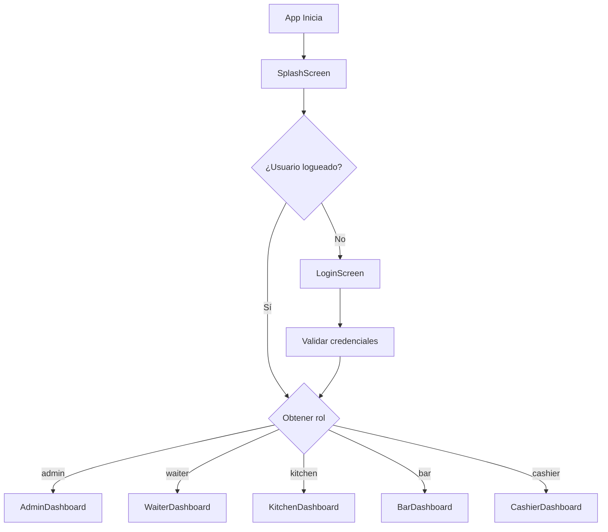
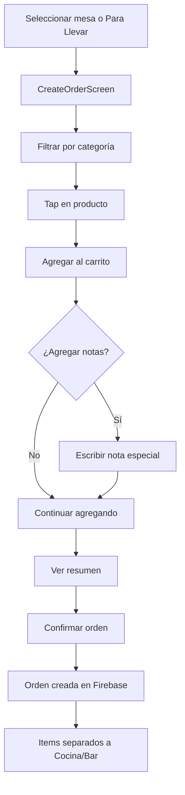
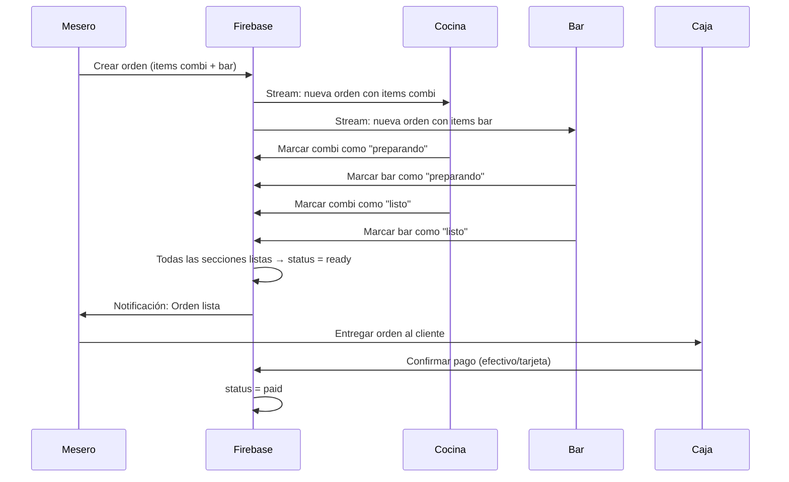

# 📱 Reporte Completo del Estado de la Aplicación
## **La Esquina Demo** - Sistema de Gestión para Negocio de Comida Rápida

**Fecha de generación:** 27 de Enero de 2026  
**Versión:** 1.0.0+1  
**Plataforma:** Android (Flutter)

---

## 📋 Tabla de Contenidos

1. [Contexto de la Aplicación](#contexto-de-la-aplicación)
2. [Plan Inicial](#plan-inicial)
3. [Lo que se Logró](#lo-que-se-logró)
4. [Arquitectura Técnica](#arquitectura-técnica)
5. [Módulos Detallados](#módulos-detallados)
6. [Modelos de Datos](#modelos-de-datos)
7. [Flujos de Trabajo](#flujos-de-trabajo)
8. [Estado Actual](#estado-actual)

---

## 🎯 Contexto de la Aplicación

**La Esquina Demo** es una aplicación móvil completa para la gestión integral de un negocio de comida rápida. Fue diseñada para optimizar las operaciones diarias de un restaurante, permitiendo la coordinación eficiente entre diferentes roles del personal: administradores, meseros, cocina, bar y caja.

### Problema que Resuelve

- **Eliminación del caos en órdenes:** Sistema centralizado que evita pérdidas de comandas físicas
- **Coordinación entre áreas:** Comunicación en tiempo real entre meseros, cocina y bar
- **Control de inventario:** Seguimiento automático de ingredientes y stock
- **Gestión financiera:** Control de pagos, ventas del día y reportes detallados
- **Toma de decisiones:** Reportes con métricas clave del negocio

### Características Principales

- ✅ **Multi-rol:** 5 roles diferenciados (Admin, Mesero, Cocina, Bar, Caja)
- ✅ **Tiempo real:** Sincronización instantánea via Firebase
- ✅ **Tema oscuro:** Diseño moderno optimizado para uso prolongado
- ✅ **Notificaciones locales:** Alertas sonoras cuando las órdenes están listas
- ✅ **Separación por secciones:** Órdenes divididas entre Cocina (combi) y Bar
- ✅ **Reportes exportables:** Generación de PDF con métricas del negocio

---

## 📐 Plan Inicial

El proyecto se planificó siguiendo una arquitectura modular basada en características (Feature-based Architecture) con los siguientes objetivos:

### Objetivos Planificados

| Objetivo | Estado |
|----------|--------|
| Sistema de autenticación con roles | ✅ Completado |
| Gestión de menú con categorías | ✅ Completado |
| Gestión de mesas por sección | ✅ Completado |
| Control de inventario con alertas | ✅ Completado |
| Creación y seguimiento de órdenes | ✅ Completado |
| Separación Cocina/Bar automática | ✅ Completado |
| Sistema de pagos (efectivo/tarjeta) | ✅ Completado |
| Reportes con exportación PDF | ✅ Completado |
| Notificaciones al mesero | ✅ Completado |

### Stack Tecnológico Elegido

```
┌─────────────────────────────────────────────────────┐
│                    FRONTEND                          │
│  Flutter + Riverpod (State Management)              │
├─────────────────────────────────────────────────────┤
│                    BACKEND                           │
│  Firebase (Auth + Firestore + Storage + Analytics) │
├─────────────────────────────────────────────────────┤
│                   EXTRAS                             │
│  fl_chart, pdf, flutter_local_notifications         │
└─────────────────────────────────────────────────────┘
```

---

## ✅ Lo que se Logró

### Funcionalidades Implementadas al 100%

1. **Autenticación completa** con Firebase Auth y roles personalizados
2. **Dashboard por rol** con navegación inteligente
3. **CRUD completo** de menú, mesas, inventario y usuarios
4. **Sistema de órdenes** con flujo completo desde creación hasta pago
5. **Separación automática** de items por sección (cocina/bar)
6. **Estados independientes** por sección (`sectionStatus`)
7. **Temporizador de órdenes** con semáforo visual (verde/naranja/rojo)
8. **Notificaciones locales** con sonido personalizado
9. **Reportes profesionales** con 3 pestañas (Resumen, Ingredientes, Productos)
10. **Exportación a PDF** con formato profesional

### Mejoras de UX Implementadas

- Áreas táctiles de 48x48 px para botones +/-
- Chips de filtro con scroll horizontal (evita overflow)
- Iconos de advertencia para items con notas especiales
- Total prominente en tarjetas de pago
- Diseño glassmorphism en tarjetas principales

---

## 🏗️ Arquitectura Técnica

### Estructura de Carpetas

```
lib/
├── core/                          # Núcleo compartido
│   ├── constants/                 # Colores, rutas, tamaños, secciones
│   ├── theme/                     # AppTheme (tema oscuro)
│   └── utils/                     # Calculadora de tiempo preparación
│
├── features/                      # Módulos por funcionalidad
│   ├── admin/                     # Módulo Administrador
│   │   ├── data/                  # Modelos y repositorios
│   │   ├── presentation/          # Pantallas y widgets
│   │   ├── providers/             # Providers Riverpod
│   │   └── utils/                 # Generador PDF
│   │
│   ├── auth/                      # Módulo Autenticación
│   │   ├── data/                  # UserModel, AuthRepository
│   │   ├── presentation/          # LoginScreen, SplashScreen
│   │   └── providers/             # authStateProvider
│   │
│   ├── waiter/                    # Módulo Mesero
│   │   ├── data/                  # OrderModel, MenuItemModel
│   │   ├── presentation/          # CreateOrderScreen, Dashboard
│   │   ├── providers/             # orderProviders
│   │   └── services/              # NotificationService
│   │
│   ├── kitchen/                   # Módulo Cocina
│   │   └── presentation/          # KitchenDashboard
│   │
│   ├── bar/                       # Módulo Bar
│   │   └── presentation/          # BarDashboard
│   │
│   ├── cashier/                   # Módulo Caja
│   │   └── presentation/          # CashierDashboard
│   │
│   └── inventory/                 # Módulo Inventario (complementario)
│
├── firebase_options.dart          # Configuración Firebase
└── main.dart                      # Entry point
```

### Patrón de Estado (Riverpod)

```dart
// Ejemplo de provider
final menuItemsProvider = StreamProvider<List<MenuItemModel>>((ref) {
  return FirebaseFirestore.instance
    .collection('menu_items')
    .snapshots()
    .map((snapshot) => snapshot.docs.map(MenuItemModel.fromFirestore).toList());
});

// Uso en widget
final menuAsync = ref.watch(menuItemsProvider);
menuAsync.when(
  data: (items) => GridView(...),
  loading: () => CircularProgressIndicator(),
  error: (e, _) => Text('Error: $e'),
);
```

---

## 📦 Módulos Detallados

### 1. 🔐 Módulo de Autenticación (`auth`)

**Propósito:** Gestionar el acceso de usuarios según su rol.

#### Pantallas

| Pantalla | Descripción |
|----------|-------------|
| `SplashScreen` | Pantalla inicial con logo animado, verifica sesión activa |
| `LoginScreen` | Formulario de email/password con validación |

#### Flujo de Autenticación



#### Roles Disponibles

| Rol | Clave | Dashboard |
|-----|-------|-----------|
| Administrador | `admin` | `/admin` |
| Mesero | `waiter` | `/waiter` |
| Cocina | `kitchen` | `/kitchen` |
| Bar | `bar` | `/bar` |
| Caja | `cashier` | `/cashier` |

---

### 2. 👔 Módulo Administrador (`admin`)

**Propósito:** Control total del negocio: menú, mesas, inventario, usuarios y reportes.

#### Pantallas

| Pantalla | Archivo | Líneas | Funcionalidad |
|----------|---------|--------|---------------|
| Dashboard | `admin_dashboard.dart` | 3,387 bytes | Navegación a sub-módulos |
| Menú | `menu_management_screen.dart` | 13,087 bytes | CRUD de productos |
| Mesas | `table_management_screen.dart` | 13,144 bytes | Gestión por sección |
| Inventario | `inventory_management_screen.dart` | 13,598 bytes | Stock con alertas |
| Usuarios | `user_management_screen.dart` | 6,496 bytes | Crear/editar usuarios |
| Reportes | `reports_screen.dart` | 34,556 bytes | Métricas y exportación |

#### 2.1 Gestión de Menú

**Colección Firebase:** `menu_items`

```dart
// Campos del producto
{
  name: String,           // Nombre del producto
  price: double,          // Precio
  category: String,       // Bebidas, Combi, Bar
  section: String,        // "combi" o "bar"
  description: String,    // Descripción opcional
  imageUrl: String?,      // URL de imagen
  isAvailable: bool,      // Disponibilidad
  modifiers: List,        // Modificadores opcionales
  prepTime: int,          // Tiempo de preparación (minutos)
}
```

**Funcionalidades:**
- ✅ Crear/editar/eliminar productos
- ✅ Asignar a categoría y sección
- ✅ Subir imagen a Firebase Storage
- ✅ Definir modificadores con precio adicional
- ✅ Marcar como disponible/no disponible

#### 2.2 Gestión de Mesas

**Colección Firebase:** `tables`

```dart
// Campos de la mesa
{
  number: int,            // Número de mesa
  section: String,        // "interior", "terraza", "bar"
  status: String,         // "available", "occupied", "reserved"
  capacity: int,          // Capacidad de personas
}
```

**Funcionalidades:**
- ✅ Crear mesas por sección (Interior, Terraza, Barra)
- ✅ Ver estado actual (disponible/ocupada/reservada)
- ✅ Identificación única por número + sección

#### 2.3 Gestión de Inventario

**Colección Firebase:** `inventory`

```dart
// Campos del ingrediente
{
  name: String,           // Nombre del ingrediente
  currentStock: double,   // Stock actual
  minStock: double,       // Stock mínimo
  maxStock: double,       // Stock máximo
  unit: String,           // Unidad (kg, L, unidades)
  costPerUnit: double,    // Costo por unidad
}
```

**Funcionalidades:**
- ✅ CRUD de ingredientes
- ✅ Colores de semáforo según stock:
  - 🔴 Rojo: stock < mínimo
  - 🟠 Naranja: stock entre mínimo y 2x mínimo
  - 🟢 Verde: stock saludable
- ✅ Actualización manual de cantidades

#### 2.4 Gestión de Usuarios

**Colección Firebase:** `users`

```dart
// Campos del usuario
{
  email: String,          // Email de acceso
  name: String,           // Nombre completo
  role: String,           // admin, waiter, kitchen, bar, cashier
  isActive: bool,         // Activo/Inactivo
  createdAt: Timestamp,   // Fecha de creación
}
```

**Funcionalidades:**
- ✅ Crear usuarios con rol específico
- ✅ El password se asigna al crear el usuario
- ✅ Activar/desactivar usuarios

#### 2.5 Reportes

**Providers de datos:**
- `salesSummaryProvider`: Ventas totales, efectivo, tarjeta
- `orderCountByDateProvider`: Cantidad de órdenes
- `ingredientsUsageProvider`: Uso de ingredientes
- `topSellingItemsProvider`: Productos más vendidos

**Pestañas del módulo:**

| Tab | Contenido |
|-----|-----------|
| Resumen | Total ventas, efectivo, tarjeta, órdenes del período |
| Ingredientes | Consumo de cada ingrediente |
| Productos | Top productos vendidos con filtro por sección |

**Filtros de período:**
- Hoy
- Ayer
- Última semana
- Último mes
- Rango personalizado

**Exportación:**
- ✅ Genera PDF profesional con todas las métricas
- ✅ Usa librería `pdf` + `printing`

---

### 3. 🍽️ Módulo Mesero (`waiter`)

**Propósito:** Tomar órdenes de clientes y dar seguimiento hasta el pago.

#### Pantallas

| Pantalla | Archivo | Funcionalidad |
|----------|---------|---------------|
| Dashboard | `waiter_dashboard.dart` | 3 tabs: Mesas, Mis Órdenes, Para Llevar |
| Crear Orden | `create_order_screen.dart` | Agregar items al carrito |

#### Widgets Principales

| Widget | Descripción |
|--------|-------------|
| `my_orders_list_widget.dart` | Lista de órdenes activas del mesero |
| `takeout_orders_widget.dart` | Órdenes para llevar |
| `order_card_widget.dart` | Tarjeta de orden con temporizador |

#### Dashboard del Mesero

**Tab 1: Mesas**
- Grid de mesas por sección (Interior, Terraza, Barra)
- Color según disponibilidad
- Tap para crear orden en esa mesa

**Tab 2: Mis Órdenes**
- Lista de órdenes activas creadas por el mesero
- Temporizador con semáforo:
  - 🟢 Verde: 0-10 minutos
  - 🟠 Naranja: 10-20 minutos
  - 🔴 Rojo: +20 minutos
- Notificación local cuando una orden está lista

**Tab 3: Para Llevar**
- Crear órdenes sin mesa
- Campos: Nombre cliente, Teléfono
- Mismo flujo que orden en mesa

#### Flujo de Creación de Orden



#### Notificaciones Locales

**Servicio:** `NotificationService`

- Inicializa canal de notificaciones Android
- Escucha cambios en órdenes del mesero actual
- Cuando `status == ready`:
  - Muestra notificación push local
  - Reproduce sonido de alerta

---

### 4. 👨‍🍳 Módulo Cocina (`kitchen`)

**Propósito:** Ver y preparar items de tipo "combi" de las órdenes.

#### Pantalla Principal

**Archivo:** `kitchen_dashboard.dart` (14,114 bytes)

#### Funcionamiento

1. **Filtro automático:** Solo muestra items donde `section == "combi"`
2. **Estados de sección:**
   - `pending`: Recién llegó la orden
   - `preparing`: En preparación
   - `ready`: Listo para servir

3. **Tarjetas de orden:**
   - Número de orden + Mesa/Para Llevar
   - Lista de items con cantidad prominente
   - Icono ⚠️ si el item tiene nota especial
   - Temporizador con semáforo de colores

4. **Acciones:**
   - Botón "Preparando" → Cambia `sectionStatus.combi` a `preparing`
   - Botón "Listo" → Cambia `sectionStatus.combi` a `ready`

5. **Lógica de orden completa:**
   - Si todas las secciones activas están en `ready`:
   - El `status` general de la orden cambia a `ready`
   - El mesero recibe notificación

---

### 5. 🍺 Módulo Bar (`bar`)

**Propósito:** Ver y preparar items de tipo "bar" de las órdenes.

#### Pantalla Principal

**Archivo:** `bar_dashboard.dart`

#### Funcionamiento

- **Idéntico al módulo cocina**, pero filtra por `section == "bar"`
- Los items de bar típicamente incluyen: Bebidas, Cocteles, Cervezas
- Estados independientes en `sectionStatus.bar`

---

### 6. 💰 Módulo Caja (`cashier`)

**Propósito:** Confirmar pagos de órdenes listas y ver historial del día.

#### Pantalla Principal

**Archivo:** `cashier_dashboard.dart` (28,575 bytes)

#### Tabs

| Tab | Contenido |
|-----|-----------|
| Pendientes | Órdenes listas esperando confirmación de pago |
| Pagadas | Historial de órdenes pagadas hoy |

#### Tarjeta de Confirmación de Pago

```
┌─────────────────────────────────────┐
│ 🧾 Orden #123          Mesa 5      │
│                                     │
│ 2x Hamburguesa............ $100.00 │
│ 1x Refresco............... $25.00  │
│ ──────────────────────────────     │
│ Subtotal:               $125.00    │
│ TOTAL:                  $125.00    │
│                                     │
│ Método de pago:                     │
│ [💵 EFECTIVO]  [💳 TARJETA]         │
│                                     │
│        [ ✓ CONFIRMAR PAGO ]        │
└─────────────────────────────────────┘
```

#### Flujo de Pago

1. Mesero crea orden → Cocina/Bar preparan
2. Secciones marcan como "listo"
3. Orden aparece en Caja como "pendiente de pago"
4. Cajero selecciona método (efectivo/tarjeta)
5. Confirma pago → `status = paid`
6. Orden pasa a historial de "Pagadas"

---

## 📊 Modelos de Datos

### OrderModel (Orden)

```dart
class OrderModel {
  final String id;
  final String orderNumber;          // Ej: "ORD-001"
  final OrderStatus status;          // pending, preparing, ready, paid, cancelled
  final OrderType orderType;         // dineIn, takeout
  final int? tableNumber;            // Null si es para llevar
  final String? tableSection;        // interior, terraza, bar
  final String? customerName;        // Nombre del cliente
  final String? customerPhone;       // Teléfono (solo takeout)
  final List<OrderItem> items;       // Lista de productos
  final double subtotal;
  final double total;
  final PaymentMethod? paymentMethod; // cash, card
  final String createdBy;            // UID del mesero
  final String createdByName;        // Nombre del mesero
  final List<String> activeSections; // ["combi"], ["bar"], o ["combi", "bar"]
  final Map<String, String> sectionStatus; // {combi: "ready", bar: "preparing"}
  final OrderTimestamps timestamps;  // createdAt, preparedAt, readyAt, paidAt
}
```

### OrderItem (Item de Orden)

```dart
class OrderItem {
  final String menuItemId;
  final String name;
  final double price;
  final int quantity;
  final String? notes;               // "Sin cebolla"
  final String section;              // "combi" o "bar"
  final List<SelectedModifier> modifiers;
}
```

### MenuItemModel (Producto del Menú)

```dart
class MenuItemModel {
  final String id;
  final String name;
  final double price;
  final String category;             // Bebidas, Hamburguesas, etc.
  final String section;              // "combi" o "bar"
  final String? description;
  final String? imageUrl;
  final bool isAvailable;
  final List<ModifierOption> modifiers;
  final int prepTime;                // Minutos de preparación
}
```

### TableModel (Mesa)

```dart
class TableModel {
  final String id;
  final int number;
  final String section;              // interior, terraza, bar
  final String status;               // available, occupied, reserved
  final int capacity;
}
```

### InventoryItemModel (Ingrediente)

```dart
class InventoryItemModel {
  final String id;
  final String name;
  final double currentStock;
  final double minStock;
  final double maxStock;
  final String unit;
  final double costPerUnit;
}
```

---

## 🔄 Flujos de Trabajo

### Flujo Completo de una Orden



---

## 📈 Estado Actual

### Métricas del Proyecto

| Métrica | Valor |
|---------|-------|
| Líneas de código | ~15,000+ |
| Archivos Dart | ~50 |
| Módulos (features) | 7 |
| Modelos de datos | 5 principales |
| Pantallas | 12 |
| Providers Riverpod | ~30 |
| Colecciones Firebase | 5 (users, menu_items, tables, orders, inventory) |

### Funcionalidades 100% Operativas

| Módulo | Estado |
|--------|--------|
| Autenticación | ✅ Completo |
| Admin - Menú | ✅ Completo |
| Admin - Mesas | ✅ Completo |
| Admin - Inventario | ✅ Completo |
| Admin - Usuarios | ✅ Completo |
| Admin - Reportes | ✅ Completo |
| Mesero - Tomar órdenes | ✅ Completo |
| Mesero - Notificaciones | ✅ Completo |
| Cocina - Preparar items | ✅ Completo |
| Bar - Preparar items | ✅ Completo |
| Caja - Confirmar pagos | ✅ Completo |

### Pendientes Opcionales

| Feature | Estado |
|---------|--------|
| Rediseño pantalla crear orden (Sandwich UI) | 📋 Planificado |
| Descuento automático de inventario | 📋 Futuro |
| Reportes de turnos por empleado | 📋 Futuro |
| Modo offline | 📋 Futuro |

---

## 🎨 Identidad Visual

| Elemento | Valor |
|----------|-------|
| Nombre de App | La Esquina Demo |
| Tema | Oscuro (Dark Theme) |
| Color primario | Café/Marrón cálido |
| Tipografía | Google Fonts (Roboto) |
| Iconos | Material Design |

---

**Fin del Reporte**

*Generado automáticamente el 27 de Enero de 2026*
